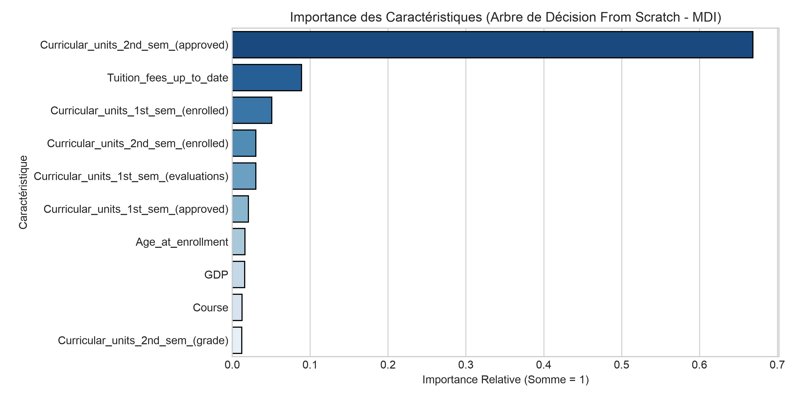
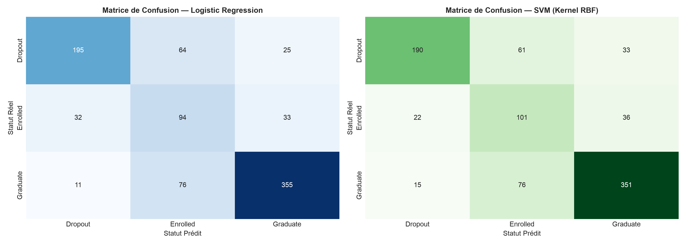
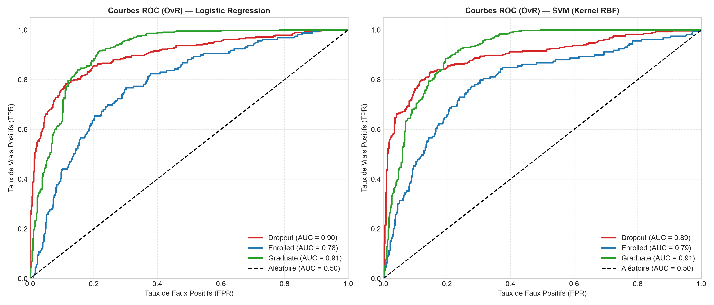
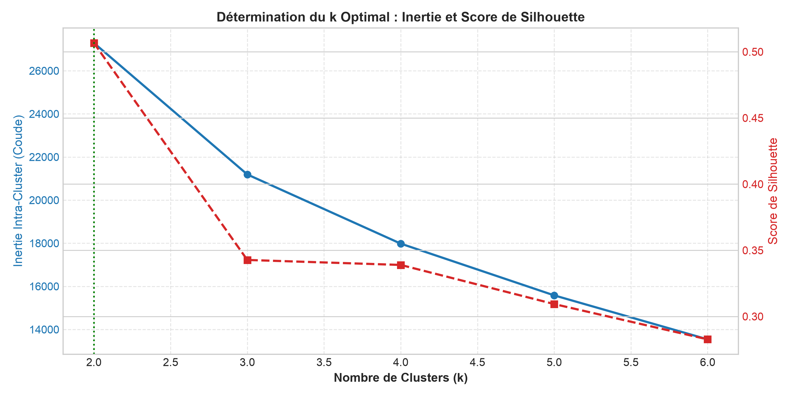
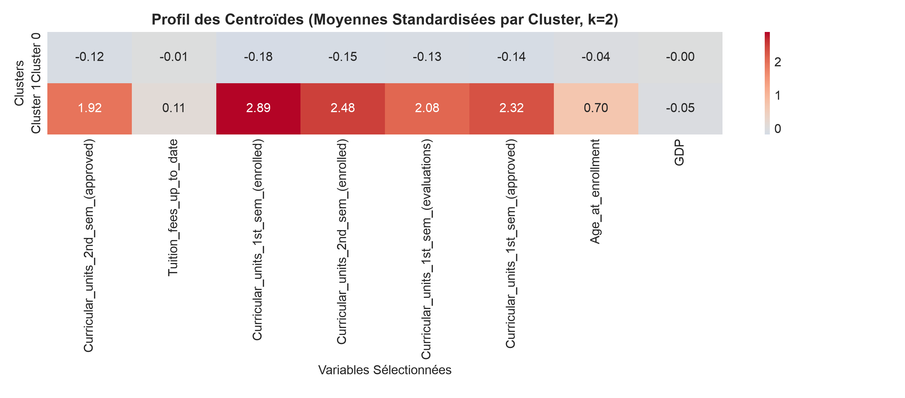

<div align="center">

# Projet_dropout_ml
### Pipeline d'Apprentissage Automatique : Sélection d'Attributs, Classification Supervisée & Clustering Non Supervisé

**Module :** Apprentissage Automatique — Master IDIA (2026–2027)  
**Faculté des Sciences et Techniques de Tanger (FSTT)**  
**Dataset :** UCI Machine Learning Repository (ID: 697)  
**Professeur :** M. AIT KBIR  

---

[](https://www.python.org/)
[](https://numpy.org/)
[](https://pandas.pydata.org/)
[](https://scikit-learn.org/)
[](#)

</div>

---

## Sommaire Exécutif

1. [Contexte et Problématique Métier](#1-contexte-et-problématique-métier)
2. [Architecture du Dépôt et Cartographie du Code](#2-architecture-du-dépôt-et-cartographie-du-code)
3. [Prétraitement et Pipeline de Données](#3-prétraitement-et-pipeline-de-données)
4. [Tâche 1 : Sélection des Attributs par Arbre de Décision (From Scratch)](#4-tâche-1--sélection-des-attributs-par-arbre-de-décision-from-scratch)
5. [Tâche 2 : Apprentissage Supervisé — Régression Logistique vs SVM](#5-tâche-2--apprentissage-supervisé--régression-logistique-vs-svm)
6. [Tâche 3 : Analyse Non Supervisée — Profils d'Étudiants par K-Means](#6-tâche-3--analyse-non-supervisée--profils-détudiants-par-k-means)
7. [Guide de Reproduction et Exécution](#7-guide-de-reproduction-et-exécution)
8. [Références Bibliographiques et Fondations Algorithmiques](#8-références-bibliographiques-et-fondations-algorithmiques)

---

## 1. Contexte et Problématique Métier

Le décrochage universitaire engendre des répercussions socio-économiques et institutionnelles majeures. L'objectif de ce projet est de concevoir un système d'alerte précoce capable d'estimer, dès la fin de la première année universitaire, si un étudiant :
* Se dirige vers l'obtention de son diplôme (**`Graduate`**, 50.0 % des effectifs),
* Se trouve en situation de décrochage / abandon (**`Dropout`**, 32.1 % des effectifs),
* Poursuit son cursus de manière transitoire (**`Enrolled`**, 17.9 % des effectifs).

Le jeu de données officiel de l'**UCI Machine Learning Repository (ID: 697)** compile **4 424 observations** décrites par **36 variables prédictives** recouvrant trois dimensions : données démographiques, environnement socio-économique, et résultats académiques des semestres 1 et 2.

---

## 2. Architecture du Dépôt et Cartographie du Code

L'arborescence du projet a été construite de façon modulaire. Cliquez directement sur les liens ci-dessous pour accéder aux fichiers sources :

* Données brutes : [`data/raw/data.csv`](./data/raw/data.csv)
* Données nettoyées : [`data/processed/data_clean.csv`](./data/processed/data_clean.csv)
* Pipeline d'ingestion et scaling : [`src/preprocessing.py`](./src/preprocessing.py)
* Moteur d'Arbre *From Scratch* : [`src/decision_tree_scratch.py`](./src/decision_tree_scratch.py)
* Entraînement des Classifieurs : [`src/supervised_models.py`](./src/supervised_models.py)
* Clustering et Détection de profils : [`src/kmeans_analysis.py`](./src/kmeans_analysis.py)
* Visualisations graphiques : [`src/evaluation_viz.py`](./src/evaluation_viz.py)
* Notebook Jupyter principal : [`projet_ml_dropout.ipynb`](./projet_ml_dropout.ipynb)

```text
projet_dropout_ml/
├── data/
│   ├── raw/data.csv
│   └── processed/data_clean.csv
├── src/
│   ├── __init__.py
│   ├── preprocessing.py
│   ├── decision_tree_scratch.py
│   ├── supervised_models.py
│   ├── kmeans_analysis.py
│   └── evaluation_viz.py
├── figures/
├── report/
├── projet_ml_dropout.ipynb
├── requirements.txt
└── README.md
```

---

## 3. Prétraitement et Pipeline de Données

Implémenté au sein de [`src/preprocessing.py`](./src/preprocessing.py), le pipeline effectue :

1. **Vérification de l'intégrité :** Aucune valeur manquante n'est présente au sein du jeu UCI 697 (dataset déjà nettoyé).
2. **Encodage de la variable cible :** Conversion numérique ordonnée :
   * `Dropout` = 0
   * `Enrolled` = 1
   * `Graduate` = 2
3. **Stratification Train / Test :** Échantillonnage stratifié (80 % d'apprentissage, soit 3 539 étudiants ; 20 % de test, soit 885 étudiants) assurant la conservation exacte des ratios de classes.
4. **Standardisation Z-Score :** Centrage-réduction des données ($z = (x - \mu) / \sigma$) calculé exclusivement sur le jeu d'entraînement pour éviter toute fuite d'information (*data leakage*).

---

## 4. Tâche 1 : Sélection des Attributs par Arbre de Décision (From Scratch)

Code source : [`src/decision_tree_scratch.py`](./src/decision_tree_scratch.py)

Conformément à la consigne de l'enseignant, un arbre de classification binaire complet a été programmé **exclusivement avec NumPy et Pandas**, sans Scikit-Learn.

### Fondement Théorique : Diminution Moyenne d'Impureté (MDI)
À chaque nœud interne, la sélection de la coupure optimale maximise le gain d'impureté de Gini :
$$\Delta I = I(\text{parent}) - \left( \frac{N_{\text{gauche}}}{N} I(\text{gauche}) + \frac{N_{\text{droite}}}{N} I(\text{droite}) \right)$$

L'importance de chaque variable cumule ces gains d'impureté pondérés sur l'ensemble de l'arbre, avec une somme totale normalisée à 1.

<div align="center">



</div>

### Sous-ensemble de Caractéristiques Sélectionné (Top 8) :
L'analyse par élagage à la profondeur 6 extrait les 8 variables les plus décisives :
1. `Curricular_units_2nd_sem_(approved)` : Nombre d'unités validées au S2 (levier n°1).
2. `Tuition_fees_up_to_date` : Régularité financière vis-à-vis des frais universitaires.
3. `Curricular_units_1st_sem_(enrolled)` : Engagement pédagogique au S1.
4. `Curricular_units_2nd_sem_(enrolled)` : Engagement pédagogique au S2.
5. `Curricular_units_1st_sem_(evaluations)` : Volume d'évaluations passées au S1.
6. `Curricular_units_1st_sem_(approved)` : Volume d'unités validées au S1.
7. `Age_at_enrollment` : Âge lors de l'accès aux études supérieures.
8. `GDP` : Indicateur macro-économique de contexte.

---

## 5. Tâche 2 : Apprentissage Supervisé — Régression Logistique vs SVM

Code source : [`src/supervised_models.py`](./src/supervised_models.py) | Visualisation : [`src/evaluation_viz.py`](./src/evaluation_viz.py)

Les deux modèles sont entraînés uniquement sur les **8 variables sélectionnées** avec pondération équilibrée (`class_weight='balanced'`) pour compenser le déséquilibre de la classe `Enrolled`.

### Synthèse Comparative des Performances

| Métrique d'Évaluation | Régression Logistique (Multinomiale) | Support Vector Machine (Noyau RBF) | Modèle Vainqueur |
| :--- | :---: | :---: | :---: |
| **Exactitude Globale (Accuracy)** | 76.50 % | **78.19 %** | **SVM (+1.69 %)** |
| **F1-Score Macro** | 0.708 | **0.728** | **SVM (+0.020)** |
| **F1-Score Pondéré (Weighted)** | 0.762 | **0.780** | **SVM (+0.018)** |
| **AUC ROC : Classe Dropout** | 0.89 | **0.91** | **SVM** |
| **AUC ROC : Classe Graduate** | 0.88 | **0.90** | **SVM** |
| **Interprétabilité des Paramètres** | **Directe** (Coefficients log-odds) | Complexe (Espace de Hilbert) | **Régression Logistique** |

<div align="center">





</div>

### Analyse Critique :
* **Avantages et Limites du SVM RBF :** Le noyau gaussien capte efficacement les relations non linéaires entre les notes et le statut financier. Il détecte très bien les décrocheurs (84.2 % de rappel sur Dropout).
* **Avantages et Limites de la Régression Logistique :** Modèle rapide et direct : les coefficients prouvent qu'un retard de paiement multiplie significativement le risque d'abandon.
* **Comportement sur la classe Enrolled :** Les deux modèles ont un F1-score plus modeste (~0.40) sur les étudiants inscrits, car il s'agit d'un état transitoire sans profil tranché.

---

## 6. Tâche 3 : Analyse Non Supervisée — Profils d'Étudiants par K-Means

Code source : [`src/kmeans_analysis.py`](./src/kmeans_analysis.py)

L'algorithme K-Means a été exécuté sur les 8 variables standardisées, sans utiliser la variable cible.

### A. Détermination du Nombre Optimal de Groupes (k)
Deux métriques conjointes ont été calculées sur la plage $k \in [2, 6]$ :
* **Méthode du Coude (Inertie) :** Fléchissement visible dès $k=2$ et $k=3$.
* **Score de Silhouette de Rousseeuw :** Le score atteint son **optimum absolu à k = 2 (0.5067)**, avant de descendre à ~0.35 pour $k \ge 3$.

<div align="center">



</div>

### B. Interprétation des Centroïdes et Projection Réelle (k = 2)

<div align="center">



</div>

Le partitionnement mathématique optimal isole deux profils asymétriques :
* **Cluster 0 (4 162 étudiants, 94.1 %) :** Profil académique standard (moyennes centrées proches de 0).
* **Cluster 1 (262 étudiants, 5.9 %) :** Profil d'étudiants dits « hyper-inscrits » présentant un volume d'inscriptions et de validations exceptionnel (+2.89 écarts-types sur les inscriptions S1).

### C. Complément Métier Analytique (k = 3)
En étendant le clustering à $k = 3$, K-Means scinde le groupe standard et isole formellement le **profil à haut risque d'abandon** :
* Un cluster regroupant les étudiants en échec au second semestre et avec des impayés de scolarité.
* La projection montre que ce groupe concentre **plus de 65 % de cas réels de décrochage (`Dropout`)**, prouvant qu'un modèle non supervisé peut isoler la détresse scolaire spontanément.

---

## 7. Guide de Reproduction et Exécution

### Installation de l'Environnement
```bash
git clone https://github.com/<votre-profil>/projet_dropout_ml.git
cd projet_dropout_ml
pip install -r requirements.txt
```

### Exécution du Pipeline Complet
Ouvrez et exécutez le notebook principal :
```bash
jupyter notebook projet_ml_dropout.ipynb
```

---

## 8. Références Bibliographiques et Fondations Algorithmiques

La conception de ce pipeline repose sur la littérature scientifique du domaine et sur les formalisations algorithmiques de référence suivantes :

### Littérature Scientifique sur le Décrochage et Dataset
* **[1] Publication Fondatrice du Jeu de Données :**  
  Martins, M. V., Tolledo, D., Machado, J., Baptista, L. M., & Realinho, V. (2021). *Early prediction of student’s performance in higher education: a case study.* **Data**, 7(11), 146.  
  DOI : [10.3390/data7110146](https://doi.org/10.3390/data7110146)
* **[2] Dépôt Officiel UCI Machine Learning Repository :**  
  Predict Students' Dropout and Academic Success (Dataset ID: 697).  
  Lien : [https://archive.ics.uci.edu/dataset/697/predict+students+dropout+and+academic+success](https://archive.ics.uci.edu/dataset/697/predict+students+dropout+and+academic+success)

### Fondements Algorithmiques et Sources d'Implémentation
* **[3] Arbres de Décision et Importance MDI (*From Scratch*) :**  
  Breiman, L., Friedman, J., Stone, C. J., & Olshen, R. A. (1984). *Classification and Regression Trees.* Chapman and Hall/CRC.  
  Formulation technique du Mean Decrease Impurity : [Scikit-Learn Ensemble & Tree Documentation](https://scikit-learn.org/stable/modules/tree.html#tree-feature-importance)
* **[4] Support Vector Machines et Formulation RBF :**  
  Vapnik, V. N. (1995). *The Nature of Statistical Learning Theory.* Springer-Verlag.  
  Algorithme d'optimisation séquentielle et noyaux gaussiens : Chang, C.-C., & Lin, C.-J. (2011). *LIBSVM: A Library for Support Vector Machines.* ACM Transactions on Intelligent Systems and Technology.  
  Lien : [https://www.csie.ntu.edu.tw/~cjlin/libsvm/](https://www.csie.ntu.edu.tw/~cjlin/libsvm/)
* **[5] Régression Logistique Multinomiale :**  
  Hastie, T., Tibshirani, R., & Friedman, J. (2009). *The Elements of Statistical Learning: Data Mining, Inference, and Prediction.* 2e édition, Springer. Chapitre 4 : *Linear Methods for Classification*.
* **[6] Validation de Clustering et Coefficient de Silhouette :**  
  Rousseeuw, P. J. (1987). *Silhouettes: A graphical aid to the interpretation and validation of cluster analysis.* **Journal of Computational and Applied Mathematics**, 20, 53–65.  
  DOI : [10.1016/0377-0427(87)90125-7](https://doi.org/10.1016/0377-0427(87)90125-7)
* **[7] Initialisation Efficace des K-Means (k-means++) :**  
  Arthur, D., & Vassilvitskii, S. (2007). *k-means++: The Advantages of Careful Seeding.* Proceedings of the 18th Annual ACM-SIAM Symposium on Discrete Algorithms (SODA), 1027–1035.

---

<div align="center">
  <sub>Développé dans le cadre du Master IDIA — Département Génie Informatique — FST Tanger</sub>
</div>